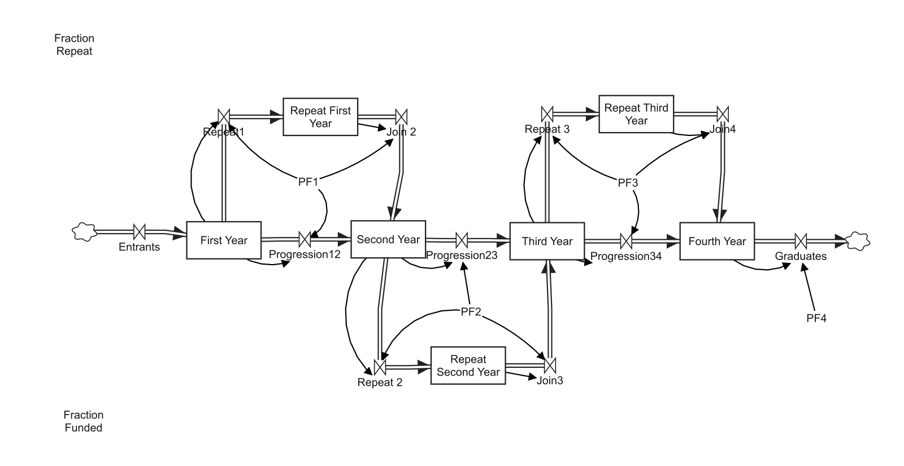
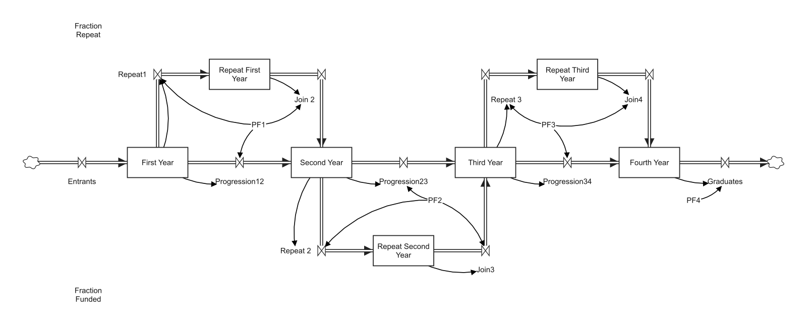
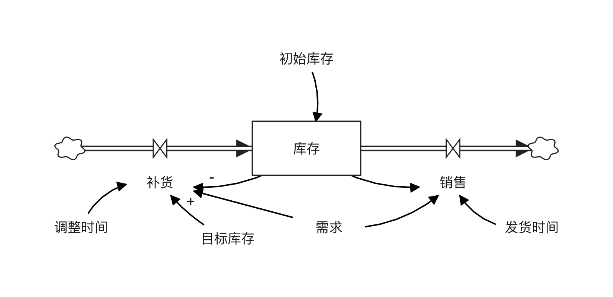
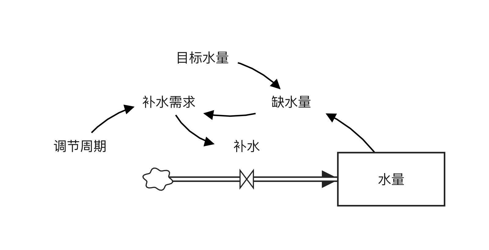
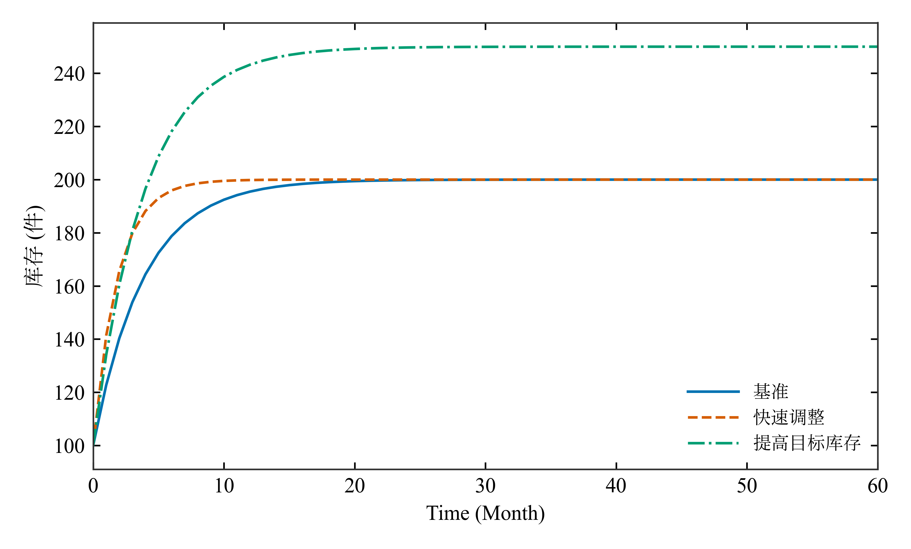
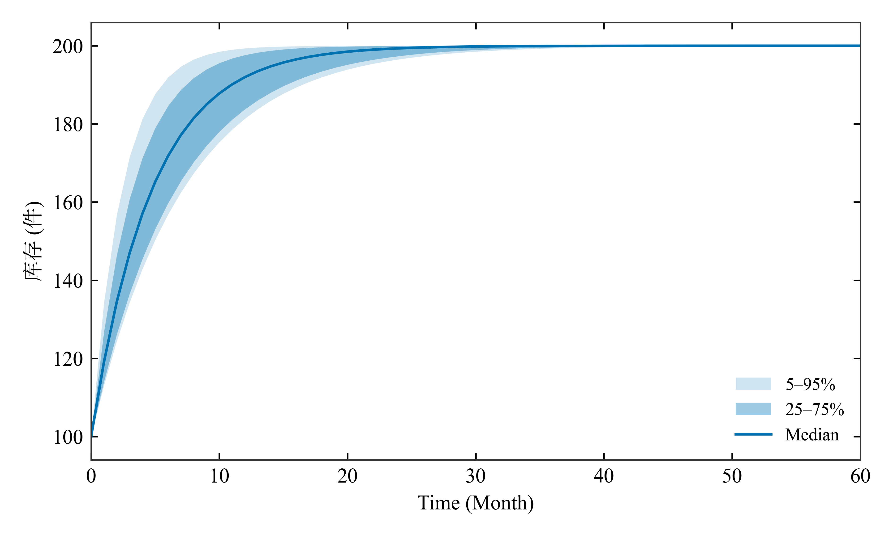

# Vensim System Dynamics Skill


[简体中文](README.md) · English

A Vensim system dynamics skill for AI coding agents (Claude Code, Codex, Cursor, Copilot and others). It reads and writes `.mdl` files that open in Vensim: it builds stock-and-flow diagrams from JSON, tidies models that someone else left messy, checks arrow polarity and feedback loops, runs reproducible simulations, scenarios, sensitivity analysis, calibration and policy search, and draws publication-ready result plots in Python.

The layout rules come from the Vensim documentation, Sterman's diagramming advice and statistics over 256 public MDL files. They live in code and are applied by commands rather than improvised by the language model, so every model that calls the skill draws by the same rules.

> Not affiliated with Ventana Systems. Open the result in Vensim and export the final diagram from there.

## What it looks like

### Tidying an existing model

Student Flows from Duggan's textbook. The original has overlapping labels, a crossing and a too-short arrow; `layout` judges it worth a rebuild, keeps the author's idea of placing repeat-year stocks alternately above and below the main chain, and puts corner valve names inside the bend.

| Original | After `layout` |
| --- | --- |
|  |  |

A well-drawn original is not redrawn. Overshoot has only two places where text touches; `layout` moves two variables and leaves every other coordinate and arc alone.

### Generating a model from JSON (Chinese variable names)

| Inventory | Water level feedback |
| --- | --- |
|  |  |

Parameters sit next to the variable they act on, loops run around a ring, and nothing crosses. The model spec is [inventory_zh.json](skills/vensim-skill/assets/templates/inventory_zh.json).

### Result plots

| Named scenarios | Monte Carlo (30 samples) |
| --- | --- |
|  |  |

No title by default, a thin frame with inward ticks and no grid; curves differ by both colour and line style so they survive black-and-white printing. Many samples become 5–95% and 25–75% bands. The style follows Rahmandad and Sterman (2012).

Diagrams on this page are rendered from the MDL by the `preview` command; text widths are estimated and differ slightly from Vensim.

## Features

| Step | Commands | What it does |
| --- | --- | --- |
| Build | `build` | Generates an MDL from a JSON spec of stocks, flows, equations and units, then lays it out and checks polarity; splits views by subsystem with automatic shadow variables |
| Check | `inspect` `audit` `check` `units` | Sketch objects, broken references, undefined variables, initialisation loops, missing units |
| Layout | `layout` `visual` | Four modes (below); `visual --strict` checks crossings, text overlap, too-short arrows and the `<Time>` slot |
| Feedback | `feedback` | Signs of partial derivatives from the equations, checked against arrow `+/-` and declared R/B loops |
| Simulate | `simulate` `crosscheck` `convergence` | Built-in Euler engine; point-by-point comparison with PySD; dt, dt/2, dt/4 convergence |
| Experiments | `experiment` | Named scenarios, one-at-a-time perturbation, grid, Monte Carlo |
| Calibration and policy | `calibrate` `optimize` | SciPy differential evolution with bounds, constraints and a simulation budget |
| Plots | `graph` `compare` `plot-data` | PNG at 600 dpi plus optional PDF and SVG; a manifest records data hashes and every setting |

Every run writes a `.run.json` with the model hash, backend version, integration method and time settings. Plotting checks it and refuses to plot stale data from a model that has since changed.

## Install

Python 3.10+. Building, layout, checks and the built-in engine use only the standard library.

```bash
# skills CLI (skills.sh)
npx skills add 1837620622/vensim-system-dynamics-skill --skill vensim-skill

# GitHub CLI
gh skill install 1837620622/vensim-system-dynamics-skill vensim-skill --scope user
```

Or clone it:

```bash
git clone https://github.com/1837620622/vensim-system-dynamics-skill.git
cd vensim-system-dynamics-skill/skills/vensim-skill
./skill.sh doctor          # Windows: skill.cmd doctor
```

`doctor` reports the interpreter, optional packages, a local Vensim install and plot fonts. Optional extras:

| Feature | Install |
| --- | --- |
| Result plots | `python -m pip install -r requirements/plots.txt` |
| PySD comparison | `python -m pip install -r requirements/pysd.txt` |
| Calibration and policy search | `python -m pip install -r requirements/analysis.txt` |

## Quick start

Once installed, describe the task to your agent, e.g. "build an inventory model in Vensim and plot three scenarios". To run the commands yourself (from `skills/vensim-skill`):

```bash
./skill.sh build assets/templates/inventory_zh.json --output work/inventory.mdl
./skill.sh visual work/inventory.mdl --strict
./skill.sh simulate work/inventory.mdl --var 库存 --output results/base.csv
./skill.sh experiment work/inventory.mdl --spec assets/templates/inventory_scenarios.json \
  --output-dir results/scenarios --plot figures/scenarios.png

# Tidy an existing model into a new file; the original is untouched
./skill.sh layout old.mdl --output old_layout.mdl
./skill.sh visual old_layout.mdl --strict
```

Commands refuse to overwrite existing outputs; use a new name when re-running.

## Layout rules

| Mode | Behaviour |
| --- | --- |
| `auto` (default) | Leaves a clean original alone; with one or two text clashes it moves only those variables or only re-routes arcs; rebuilds only when problems are widespread |
| `natural` | Full rebuild; used by `build` for new models |
| `refine` | Moves auxiliaries only; stocks, valves and flow names stay put |
| `preserve` | Keeps coordinates and re-routes arcs only |

Main rules and their sources:

- Stock boxes are at least 96×48 and long names wrap to two lines inside the box; cloud to valve is 80 px, valve to stock at least 120 px (medians of 76 px and 124 px in Vensim's own examples).
- Information links are single-control-point arcs with a target bow (sagitta/chord) of 0.12 (median 0.14 in the official examples); straight lines only where an arc would cross or graze text.
- Stock chains run horizontally with at least 200 px between rows (textbook median about 180 px). Flows that skip a stock become a detour branch or a right-angle bypass pipe, both taken from Duggan's diagrams.
- R/B loop markers go back inside the loop they label; hidden variables are skipped together with their arrows (Vensim Hide/unhide).
- Zero crossings. Where the structure is non-planar (K3,3), a shadow variable carries the link, and each such split is listed in the report.
- Large models are split into views by subsystem, 6–40 defined variables each, with no fragment views (Vensim, *How Views Work*).

Full rules: [APPEARANCE.md](skills/vensim-skill/references/APPEARANCE.md) (Chinese).

## Reference models

[reference_models](skills/vensim-skill/assets/reference_models/README.md) holds seven real textbook models: five from Duggan's *System Dynamics Modeling with R* and two from the SDXorg test suite, all MIT licensed and byte-identical to upstream. They cover single chains, aging chains, detours, multiple views and shadow variables, and serve two purposes: showing how the authors drew similar structures, and guarding layout and simulation against regressions. The built-in engine and PySD agree on every variable of all seven models.

## Layout of the repository

```text
skills/vensim-skill/
├── SKILL.md              entry point: hard rules, workflow, commands
├── skill.sh / skill.cmd  macOS, Linux and Windows launchers
├── scripts/              parsing, layout, checks, simulation, plotting
├── references/           rule documents loaded on demand
├── assets/templates/     JSON templates for models, experiments, layout, plots
├── assets/examples/      two Chinese example MDLs
├── assets/reference_models/  seven textbook models and their licences
└── requirements/         optional dependencies and version floors
tests/                    regression tests
docs/                     development notes and README images
```

## Development

```bash
python -m pip install -r skills/vensim-skill/requirements/dev.txt
python -m pytest -q
python -m ruff check . && python -m ruff format --check .
python -m bandit -r skills/vensim-skill/scripts -q
```

The CI configuration covers Ubuntu, macOS and Windows with Python 3.10–3.12; locally on macOS the full suite passes on Python 3.12 with PySD, matplotlib and SciPy installed, and the core suite (no optional packages) passes on 3.10 and 3.14. See [DEVELOPMENT.md](docs/DEVELOPMENT.md). Sources and known limits are listed in [REFERENCES.md](skills/vensim-skill/references/REFERENCES.md).

## Known limits

- The built-in engine covers common scalar functions; use PySD or Vensim for arrays, macros and external data.
- Agreement between the two Python backends does not prove agreement with Vensim.
- PySD cannot parse some older official examples or models with arrays.
- Text widths and wrapping are estimates; Vensim has the final say on appearance.

## Author and licence

Author: 传康KK (万能程序员) · GitHub [1837620622](https://github.com/1837620622)

Non-commercial learning, research and personal use only. Commercial use, paid redistribution and commercial client work are prohibited. Copies, modifications and non-commercial redistribution must keep the attribution and the licence; see [LICENSE](LICENSE). Third-party models in `reference_models` keep their own MIT licences.
