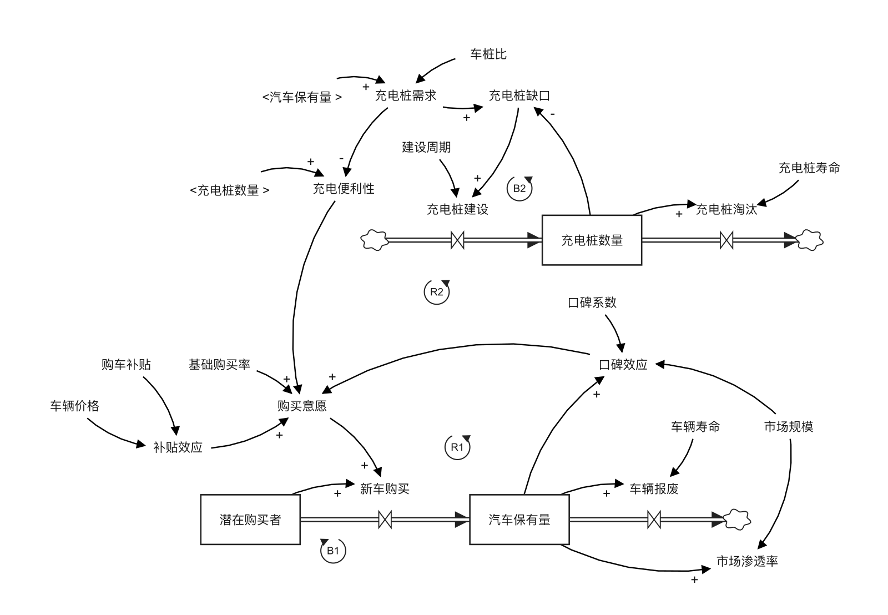

# Vensim System Dynamics Skill


简体中文 · [English](README.en.md)

给 AI 编程助手（Claude Code、Codex、Cursor、Copilot 等）用的 Vensim 系统动力学 Skill。它直接读写可在 Vensim 中打开的 `.mdl` 文件：按 JSON 生成存量流量图，整理别人画乱的模型，核对箭头极性和回路，跑可复现的仿真、情景、敏感性、校准和政策搜索，再用 Python 出论文用的结果图。

排版规则来自 Vensim 官方文档、Sterman 的绘图建议和对 256 个公开 MDL 的统计，写在代码里由命令执行，不靠大模型临场发挥。换哪个模型调用，画出来的图都是同一套规矩。

> 本项目与 Ventana Systems 无隶属关系。最终结构图请在 Vensim 中打开核对后导出。

## 效果

### 整理已有模型

Duggan 教材的 Student Flows 模型。原图有文字重叠、连线交叉和过短箭头；`layout` 判断问题较多，整体重建，保留了作者“留级存量交替画在主干上下”的结构，拐角阀门的名字放在夹角内侧。

| 原图 | `layout` 之后 |
| --- | --- |
|  |  |

画得好的原图不会被重画。Overshoot 模型原图有两处文字相压，另有两条箭头穿过变量名。`layout` 挪开 2 个变量后，文字相压全部消除，穿字只剩作者原来的一条弧线（报告中会列出），其余坐标和弧线保持原样。

### 从 JSON 生成中文模型

| 库存补货（两个平衡回路） | 水量负反馈 |
| --- | --- |
|  |  |

更复杂的完整模板：新能源汽车推广，3 个存量、4 条回路、共 23 个变量，`build` 一次生成，几何检查、`check --strict` 都通过。



参数放在它直接影响的变量旁边，R/B 回路标记落在各自回路中央，零交叉。建模 JSON 见 [ev_adoption_zh.json](skills/vensim-skill/assets/templates/ev_adoption_zh.json)，写新模型时照这个写法起步。

### 仿真结果图

| 命名情景 | 蒙特卡洛（30 次抽样） |
| --- | --- |
|  |  |

默认无标题、细边框、刻度朝内、无网格，曲线用颜色和线型同时区分，黑白打印也分得清；样本多时改画 5–95% 和 25–75% 分位带。样式参照 Rahmandad 与 Sterman（2012）的报告规范。

结构图由 `preview` 命令从 MDL 渲染，字宽是估算值，与 Vensim 中的显示略有差别。

## 功能

| 环节 | 命令 | 说明 |
| --- | --- | --- |
| 建模 | `build` `fix` | 由 JSON 写明存量、流向、方程、单位，生成 MDL 并完成排版和极性核对；按 `feedback_loops` 画出核对过的 R/B 回路标记，没声明时给出可直接粘贴的回路建议；可按子系统分视图，跨视图自动生成影子变量；`fix` 按显式选项补单位、删除断裂的箭头、把没人用的输出指标标为 Supplementary |
| 检查 | `inspect` `audit` `check` `units` | 草图对象、断裂引用、未定义变量、初值循环、缺失单位；`check --strict` 还要求没有 Vensim 的 USE FLAG（没有被使用的变量），打开模型时不再提示 |
| 排版 | `layout` `visual` `preview` | 四种模式（见下文）；`visual --strict` 检查交叉、压字、重叠、过短箭头和 `<Time>` 预留区；`preview` 生成草图 HTML，字宽为估算值，只用于定位问题 |
| 反馈 | `feedback` | 按方程求偏导符号，核对箭头 `+/-` 和指定回路的 R/B |
| 仿真 | `simulate` `crosscheck` `convergence` | 内置 Euler 引擎；与 PySD 逐点对照；dt、dt/2、dt/4 步长收敛检查 |
| 实验 | `experiment` | 命名情景、单因素扰动、网格、蒙特卡洛 |
| 校准与政策 | `calibrate` `optimize` | SciPy 差分进化，有界参数、约束和仿真次数上限 |
| 出图 | `graph` `compare` `plot-data` | PNG 600 dpi，可同时导出 PDF、SVG；清单记录数据哈希和全部参数 |

每次仿真都写一份 `.run.json`，记录模型哈希、后端版本、积分方法和时间设置；出图时会核对它，模型改过就拒绝用旧数据出图。

## 安装

需要 Python 3.10+。建模、排版、检查和内置仿真只用标准库。

```bash
# skills CLI（skills.sh）
npx skills add 1837620622/vensim-system-dynamics-skill --skill vensim-skill

# GitHub CLI
gh skill install 1837620622/vensim-system-dynamics-skill vensim-skill --scope user
```

或者直接克隆：

```bash
git clone https://github.com/1837620622/vensim-system-dynamics-skill.git
cd vensim-system-dynamics-skill/skills/vensim-skill
./skill.sh doctor          # Windows: skill.cmd doctor
```

`doctor` 报告解释器、可选依赖、本机 Vensim 和中文绘图字体。可选依赖按需安装：

| 功能 | 安装 |
| --- | --- |
| 结果图 | `python -m pip install -r requirements/plots.txt` |
| PySD 对照 | `python -m pip install -r requirements/pysd.txt` |
| 校准与政策搜索 | `python -m pip install -r requirements/analysis.txt` |

## 快速开始

装好之后直接对助手说需求即可，例如“用 Vensim 建一个库存补货模型，中文变量，跑三个情景出图”。也可以手动运行（在 `skills/vensim-skill` 目录下）：

```bash
./skill.sh build assets/templates/inventory_zh.json --output work/inventory.mdl
./skill.sh visual work/inventory.mdl --strict
./skill.sh check work/inventory.mdl --strict
./skill.sh simulate work/inventory.mdl --var 库存 --output results/base.csv
./skill.sh experiment work/inventory.mdl --spec assets/templates/inventory_scenarios.json \
  --output-dir results/scenarios --plot figures/scenarios.png

# 整理已有模型：输出新文件，原文件不动
./skill.sh layout old.mdl --output old_layout.mdl
./skill.sh visual old_layout.mdl --strict
```

输出文件已存在时命令会拒绝覆盖，重跑请换新文件名。

## 排版规则

| 模式 | 做什么 |
| --- | --- |
| `auto`（默认） | 原图合格就不动；只有一两处压字时只挪那几个变量，或只重排弧线；问题多时才整体重建 |
| `natural` | 整体重建，`build` 新建模型时使用 |
| `refine` | 只移动辅助变量，存量、阀门、流量名不动 |
| `preserve` | 坐标不动，只重排弧线 |

几条主要规则和依据：

- 存量方框最小 96×48（官方示例中位数约 104×56），中文名 10 个字以内一行写完，更长的折成长度相近的两行；云到阀门 80px，阀门到存量不少于 120px（官方示例中位数 76px、124px）。
- 信息线是单控制点圆弧，弧度（矢高/弦长）目标 0.12（官方示例中位数 0.14）；只在弧线会交叉或擦字时用直线。
- 存量链水平排列，相邻两行中心至少隔 200px（教材模型中位数约 180px）。跳过中间存量的流量画成绕行支路或直角折线管道，两种画法都取自 Duggan 教材原图。
- R/B 回路标记在排版时是占位的节点：被所属回路的中心吸引、落在回路里面，其他变量围绕它排布，圈的方向按回路走向画；隐藏的变量连同进出箭头一起不画（Vensim Hide/unhide 文档）。
- 新建模型自动避开 Vensim 打开时的 USE FLAG 提示：没人用的输出指标标 Supplementary，没人用的常量直接报错（Vensim 文档：未使用变量只是提示、不影响仿真，标 Supplementary 可消除）。
- 零交叉。结构上不可平面时（如 K3,3）用影子变量引出连线，报告逐条列出。
- 大模型按子系统分视图，视图之间用变量或影子变量连接（Vensim *How Views Work*）。每个视图 6–40 个定义变量是本工具的设计取值，不做碎视图。

完整规则见 [APPEARANCE.md](skills/vensim-skill/references/APPEARANCE.md)。

## 参考模型

[reference_models](skills/vensim-skill/assets/reference_models/README.md) 收录了 7 个真实教材模型（Duggan *System Dynamics Modeling with R* 5 个、SDXorg 测试模型 2 个，均为 MIT 许可，与上游逐字节一致），覆盖单链、老化链、绕行支路、多视图和影子变量。它们有两个用途：排版时参考作者的画法，测试时检查排版和仿真没有退化。内置引擎与 PySD 对这 7 个模型的全部标量变量逐点一致，缩放误差不超过 1e-15；图形函数不能单独导出，由调用它的变量间接检验。

## 目录

```text
skills/vensim-skill/
├── SKILL.md              技能入口：硬性规则、工作顺序、命令
├── skill.sh / skill.cmd  macOS、Linux 与 Windows 入口
├── scripts/              解析、排版、检查、仿真、出图
├── references/           按需阅读的规则说明
├── assets/templates/     建模、实验、排版、出图 JSON 模板
├── assets/examples/      两个中文示例 MDL
├── assets/reference_models/  7 个教材模型及其许可证
└── requirements/         可选依赖与版本下限
tests/                    回归测试
docs/                     开发说明与 README 图片
```

## 开发

```bash
python -m pip install -r skills/vensim-skill/requirements/dev.txt
python -m pytest -q
python -m ruff check . && python -m ruff format --check .
python -m bandit -r skills/vensim-skill/scripts -q
```

CI 配置覆盖 Ubuntu、macOS、Windows 和 Python 3.10–3.12；本地在 macOS 上用 Python 3.12（装齐 PySD、matplotlib、SciPy）跑过全部测试，3.10 和 3.14 跑过不含可选依赖的核心测试。详见 [DEVELOPMENT.md](docs/DEVELOPMENT.md)。规则依据与已知边界见 [REFERENCES.md](skills/vensim-skill/references/REFERENCES.md)。

## 已知边界

- 内置引擎覆盖常见标量函数；数组、宏、外部数据请用 PySD 或 Vensim。
- 两个 Python 后端一致，不代表与 Vensim 逐点相同。
- PySD 解析不了部分老版本官方示例和带数组的模型。
- 字宽和折行是估算值，最终图面以 Vensim 为准。

## 作者与许可

作者：传康KK（万能程序员） · GitHub [1837620622](https://github.com/1837620622)

仅限非商业学习、研究和个人使用；禁止商业使用、付费分发和商业客户交付。复制、修改和非商业再分发须保留作者署名和许可证，见 [LICENSE](LICENSE)。`reference_models` 中的第三方模型保留各自的 MIT 许可。
